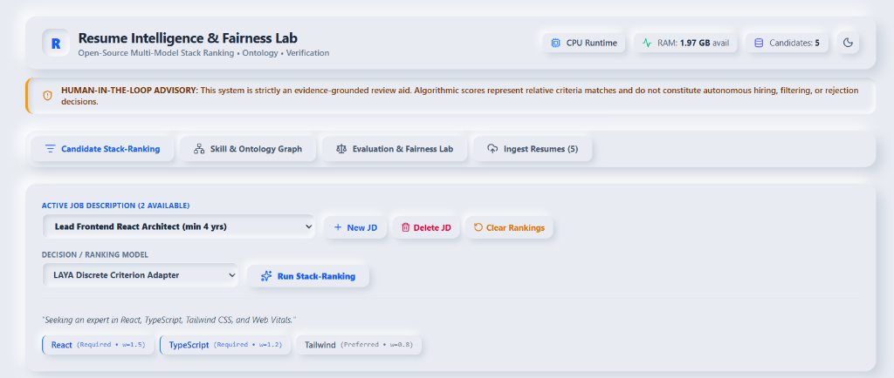
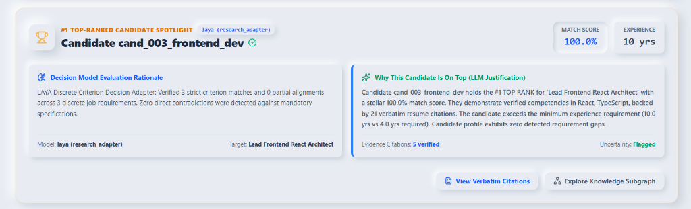
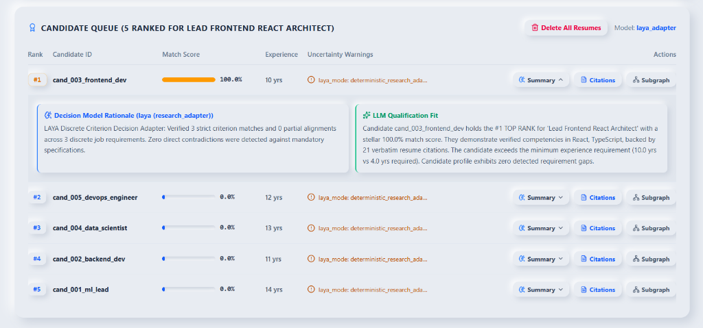

# Resume Intelligence, Ranking & Fairness Lab

> An open-source, local-first platform for evidence-grounded resume-to-job matching, multi-criteria decision modeling, skill ontology graph analysis, and diagnostic fairness benchmarking.

[](https://github.com/PRATHMESHTALHANDE/Resume-Stackranking-Decision-model-ontology-Harness2/actions)
[](https://www.python.org/)
[](https://react.dev/)
[](https://tailwindcss.com/)
[](LICENSE)
[](#)
[](#)

---

## ⚠️ Important Human-in-the-Loop Advisory
**This application is a decision-support review aid designed exclusively for human recruiters and researchers. It does NOT make autonomous hiring, rejection, or candidate disqualification decisions.** All match scores represent relative algorithmic multi-criteria alignments and must be independently verified against verbatim source citations by a human reviewer.

---

## 🖥️ System Walkthrough: Multi-JD & Decision Model Stackranking

The platform features an accessible Neumorphic Soft UI (WCAG 2.2 AA compliant) designed to provide full transparency, explainability, and multi-criteria evaluation across candidates.

### 1. Multi-Job Description Specification & Model Selection



* **What this image depicts:**
  * **Multi-JD Management:** Recruiters can switch seamlessly between multiple target Job Descriptions (e.g., `Lead Frontend React Architect (min 4 yrs)`) or create new ones via the **`+ New JD`** modal with weighted criteria.
  * **Weighted Criterion Specification:** Each job role establishes granular, weighted requirements (e.g., `React` [Required, weight: 1.5], `TypeScript` [Required, weight: 1.2], `Tailwind` [Preferred, weight: 0.8]).
  * **Independent Decision Model Selection:** Choose from 7 modular ranking architectures—including the **`LAYA Discrete Criterion Adapter`**, **`TOPSIS Ideal-Point Scorer`**, **`Weighted Multi-Feature`**, **`LambdaMART`**, and **`RRF Hybrid`**—to rank the candidate pool independently for each job.
  * **Granular Controls:** Buttons to **`Delete JD`**, **`Clear Rankings`** for the active JD, or trigger **`Run Stack-Ranking`**.

---

### 2. #1 Top-Ranked Candidate Spotlight (Dual Explanations)



* **What this image depicts:**
  * **Spotlight Card:** When stackranking completes, the top-ranked candidate (`cand_003_frontend_dev`) is featured with a gold trophy banner, match score (`100.0%`), and verified experience (`10 yrs`).
  * **Decision Model Evaluation Rationale:** Displays the algorithmic proof of how the active decision model evaluated the candidate. Under the **LAYA Discrete Criterion Adapter**, it confirms:
    > *"Verified 3 strict criterion matches and 0 partial alignments across 3 discrete job requirements. Zero direct contradictions were detected against mandatory specifications."*
  * **Why This Candidate Is On Top (LLM Justification):** A natural language, evidence-grounded hiring summary explaining why the candidate is qualified:
    > *"Candidate cand_003_frontend_dev holds the #1 TOP RANK for 'Lead Frontend React Architect' with a stellar 100.0% match score. They demonstrate verified competencies in React, TypeScript, backed by 21 verbatim resume citations. The candidate exceeds the minimum experience requirement (10.0 yrs vs 4.0 yrs required). Candidate profile exhibits zero detected requirement gaps."*
  * **Traceability Actions:** Direct links to **`View Verbatim Citations`** (opening exact resume snippets) and **`Explore Knowledge Subgraph`** (viewing ESCO ontology relationships).

---

### 3. Stack-Ranked Review Queue & Inline Explainers



* **What this image depicts:**
  * **Candidate Queue:** Ranks all ingested candidates from top to bottom (`#1` through `#5`) based on multi-attribute scoring against the active role.
  * **Inline Dual Summaries:** Clicking the **`Summary`** button expands any candidate row inline, displaying both the **Decision Model Rationale** and the **LLM Qualification Fit** side-by-side.
  * **Gaps & Uncertainty Flags:** Displays detected timeline gaps, unverified claims, or missing required competencies (e.g., flagging non-matching candidate profiles).
  * **Lifecycle Management:** Includes the **`Delete All Resumes`** control to bulk wipe uploaded resumes, parsed profiles, and ranking history in a single action.

---

## 🌟 Key Features

1. **Evidence-Grounded Ingestion & Parsing:**
   - Supports PDF and DOCX formats locally via PyMuPDF (`fitz`) and `python-docx`.
   - Every qualification claim anchors to verbatim citations with exact page numbers and section provenance.
   - Instant SHA-256 deduplication and parser caching.

2. **Multi-Model Retrieval & Decision Engine:**
   - **LAYA System-1 Decision Model (`convaiinnovations/laya`):** Real non-autoregressive neural decision model (ModernBERT-large 421M params) evaluating candidate evidence against discrete typed criteria in a single forward pass with zero text-generation hallucinations.
   - **Ensemble Symbiosis ("Select All" Consensus):** Multi-model consensus ranking running TOPSIS, LAYA, Weighted Scorer, RRF Hybrid, Dense MiniLM, and BM25 concurrently with cross-model agreement rates.
   - **TOPSIS Decision Analysis:** Multi-criteria geometric distance to Positive/Negative Ideal Solutions.
   - **Weighted Criterion Scoring:** Transparent recruiter-controlled requirement weights with dynamic criteria % vs. tenure % sliders.
   - **LightGBM LambdaMART:** Supervised Learning-to-Rank optimizing listwise nDCG.
   - **RRF (Reciprocal Rank Fusion):** Hybrid fusion combining lexical and semantic signals.
   - **Dense Semantic Vector Search:** `sentence-transformers/all-MiniLM-L6-v2` cosine similarity.
   - **BM25 Lexical Search:** Accurate technical keyword and exact acronym matching (`C++`, `.NET`, `AWS`).


3. **ESCO Skill Taxonomy & Knowledge Graph:**
   - Canonical concept mapping against the official European Skills/Competences classification.
   - Multi-stage normalizer (Exact ➔ Alias ➔ Fuzzy ➔ Semantic).
   - In-memory heterogeneous graph (NetworkX) visualized interactively via Cytoscape.js.

4. **Robustness & Fairness Diagnostics:**
   - Counterfactual identity perturbation suite auditing rank shifts under name/pronoun swaps.
   - Selection rate disparity and demographic parity metrics (4/5ths rule, disparate impact).

5. **Accessible Neumorphic (Soft UI) Dashboard:**
   - Custom soft-UI dual-shadow aesthetic built with React 19, Vite, TypeScript, and Tailwind CSS v4.
   - Full light (`#E8ECF2`) and dark (`#14171C`) themes meeting WCAG 2.2 AA accessibility standards.

6. **100% Local-First & Zero Global Disk Pollution:**
   - All model weights and caches reside strictly within `<project_root>/models/weights/` and `models/cache/`.
   - Zero unmonitored disk caching (`~/.cache/huggingface` is completely disabled).

---

## 🛠️ Quickstart

### Prerequisites
- Windows 11 (or Linux/macOS)
- Python 3.11 (`uv` recommended)
- Node.js v20+ / v22+

### Installation & Launch

1. **Clone the repository:**
   ```bash
   git clone https://github.com/PRATHMESHTALHANDE/Resume-Stackranking-Decision-model-ontology-Harness2.git
   cd "Resume-Stackranking-Decision-model-ontology-Harness2"
   ```

2. **Set up Python environment with `uv`:**
   ```powershell
   uv venv --python 3.11
   uv sync --extra dev
   ```

3. **Run automated test suite (48 tests):**
   ```powershell
   uv run pytest tests/ -v
   ```

4. **Start the FastAPI Backend (Port 8001):**
   ```powershell
   uv run uvicorn apps.api.main:app --host 127.0.0.1 --port 8001 --reload
   ```

5. **Start the Neumorphic Web Dashboard (From root or `apps/web`):**
   ```powershell
   npm run dev
   ```
   Open **`http://localhost:5173`** in your browser.

---

## 📚 Documentation Catalog

Comprehensive standalone documentation for every tool and model used is maintained in [`docs/resources/`](docs/resources/README.md):
- [FastAPI](docs/resources/fastapi.md) | [Pydantic](docs/resources/pydantic.md) | [PyMuPDF](docs/resources/pymupdf.md)
- [MiniLM Embeddings](docs/resources/sentence-transformers-all-minilm-l6-v2.md) | [BM25](docs/resources/rank-bm25.md) | [ESCO Ontology](docs/resources/esco-ontology.md)
- [TOPSIS Ranker](docs/resources/topsis.md) | [LightGBM LambdaMART](docs/resources/lightgbm.md) | [Laya Decision Model](docs/resources/laya-decision-model.md)
- [NetworkX](docs/resources/networkx.md) | [ranx Benchmark](docs/resources/ranx.md) | [Fairlearn](docs/resources/fairlearn.md)
- [Tailwind Neumorphism](docs/resources/tailwind-css-neumorphism.md) | [Cytoscape.js](docs/resources/cytoscape-js.md) | [ECharts](docs/resources/apache-echarts.md)

---

## 📄 License & Compliance
This project is licensed under the [MIT License](LICENSE).
- Model cards: [`MODEL_CARDS.md`](MODEL_CARDS.md)
- Dataset cards: [`DATASET_CARDS.md`](DATASET_CARDS.md)
- Third-party component notices: [`THIRD_PARTY_NOTICES.md`](THIRD_PARTY_NOTICES.md)
